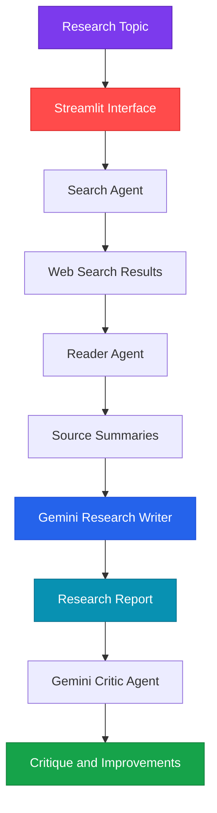

# ResearchMind — AI-Powered Research Assistant

<p align="center">
  
  
  
</p>

<p align="center">
  <b>From research questions to structured insights.</b><br/>
  An AI-powered research assistant that searches the web, analyzes sources, generates research reports, and critiques its own output using Gemini-backed agents.
</p>

<p align="center">
  <a href="#features">Features</a> •
  <a href="#architecture">Architecture</a> •
  <a href="#installation">Installation</a> •
  <a href="#configuration">Configuration</a>
</p>

---

## Overview

**ResearchMind** streamlines the research workflow by combining web search, source analysis, AI-powered writing, and automated critique in a single Streamlit application.

Users can enter a topic and follow a structured workflow that transforms research inputs into a well-organized report draft.

## Features

- **Web Research:** Discover relevant search results for a research topic.
- **Source Analysis:** Retrieve and summarize content from a selected URL.
- **AI Report Generation:** Use Google Gemini to turn research inputs into a structured report.
- **Intelligent Critique:** Review generated output and identify potential weaknesses.
- **Interactive Interface:** Access the research workflow through Streamlit.
- **Modular Agents:** Separate search, reading, writing, and critique responsibilities.

## Technology Stack

<p align="center">
  
</p>

<p align="center">
  
  
  
  
</p>

| Technology | Purpose |
|---|---|
| Python 3.13 | Application logic and agent orchestration |
| Streamlit | Interactive research interface |
| Google Gemini API | Research writing and critique |
| Search tools | Discover relevant web sources |
| Scraping tools | Retrieve and summarize selected web pages |

## Architecture

The following diagram uses GitHub-compatible Mermaid syntax.



## Project Structure

```text
ResearchMind/
├── app.py              # Streamlit frontend
├── agents.py           # Gemini agents and prompt templates
├── tools.py            # Web search and scraping helpers
├── requirements.txt    # Python dependencies
├── .env                # Local API key configuration
└── .gitignore          # Excludes secrets and cache files
```

## Installation

### 1. Clone the Repository

```bash
git clone YOUR_REPOSITORY_URL
cd ResearchMind
```

Replace `YOUR_REPOSITORY_URL` with your GitHub repository URL.

### 2. Install Dependencies

Using Python 3.13 on Windows:

```bash
python -m pip install -r requirements.txt
```

If you have multiple Python versions installed, you can explicitly use Python 3.13:

```bash
py -3.13 -m pip install -r requirements.txt
```

### 3. Configure Your API Key

Create a `.env` file in the project root:

```env
GEMINI_API_KEY=your_gemini_api_key_here
```

Get an API key from [Google AI Studio](https://aistudio.google.com/).

**Security:** Never commit your `.env` file or expose your API key in screenshots, logs, or public source code.

### 4. Launch ResearchMind

```bash
python -m streamlit run app.py
```

Alternatively, if using the Python launcher:

```bash
py -3.13 -m streamlit run app.py
```

Open the local URL displayed in your terminal, usually:

[http://localhost:8501](http://localhost:8501)

## How It Works

1. **Enter a topic:** Specify the subject you want to investigate.
2. **Search the web:** Find potentially relevant sources.
3. **Analyze a source:** Retrieve and summarize a selected URL.
4. **Generate a report:** Create a structured research draft using Gemini.
5. **Critique the report:** Review the generated output for weaknesses and possible improvements.

## Configuration

| File | Responsibility |
|---|---|
| `app.py` | Streamlit interface and application workflow |
| `agents.py` | Gemini agent wrappers and prompt templates |
| `tools.py` | Search and scraping utilities |
| `requirements.txt` | Python dependency management |
| `.env` | Local API credentials |

The configured model is `gemini-flash-lite-latest`. If you encounter quota or rate-limit errors, check your API usage, model availability, and account limits.

## Responsible Research

ResearchMind helps accelerate research, but AI-generated reports should not be treated as automatically verified academic work.

- Verify important claims against original sources.
- Check citations, dates, and source credibility.
- Review AI-generated summaries for omissions or inaccuracies.
- Respect website access policies when scraping content.
- Keep API credentials private.

---

<p align="center">
  <b>ResearchMind</b><br/>
  <i>Search smarter. Think deeper. Research better.</i>
</p>
